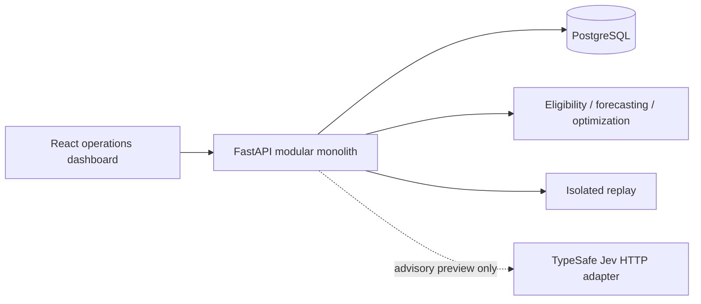

# Architecture

The repository implements one FastAPI process, PostgreSQL, and a static React/Vite frontend. PostgreSQL contains operational state, the active dataset/version, event identity, workflow transitions, application-append-only audit records, and isolated simulation results.

A proposal never changes a physician assignment. The persisted sequence is `proposed → approved_for_contact → physician_accepted → assigned → verified`. Rejection, decline, stale state, and expiry stop further assignment. Every commit rechecks rules and consent while holding the active-state lock. Verification requires a stored activation event after assignment and current operational rule checks.

`source_version` changes for material operational mutations. Approval and consent update `workflow_version` independently. Dashboard polling recalculates time-sensitive rules with an injected UTC clock and does not advance source_version. Proposals have a finite validity window and are revalidated at action time.

Raw event identity is unique by dataset/source/event ID. A semantic hash distinguishes a retry from conflicting reuse. The raw event, state update, version, invalidation, and audit entry share one transaction. Late observations remain evidence; sequence/time ordering prevents newer source information from being overwritten by arrival order.

Jev uses one shared bounded HTTPX client. Preview creates a proposal in a short transaction, releases the transaction before the HTTP evaluation, and checks the dataset/version again before storing the answer. Dashboard polls make no external AI calls.

Simulation clones an operational snapshot. Both policies receive the same scenario and exogenous events at the same simulated time. Only the resulting run record and audit entry are persisted; simulation does not modify live assignments or the active dataset.

The selected verified runtime is local Docker Compose. Conditional AWS support targets ECS Express Mode using approved existing workshop resources. No AWS resources or public URL have been created. See `deployment.md` for exact preconditions and tooling checks.
