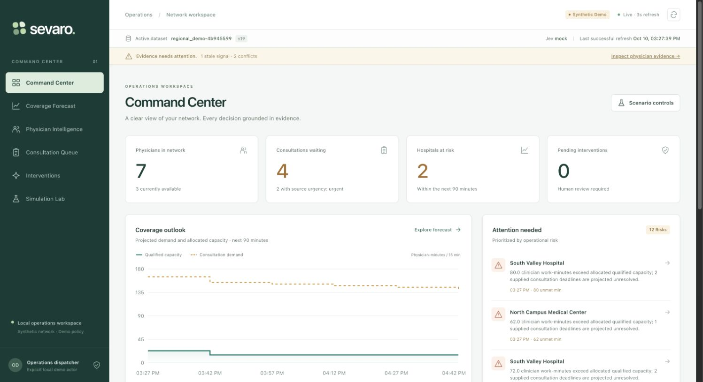

# Implementation and verification report

Verified locally on October 10, 2026. The running application is at [localhost:5173](http://localhost:5173); the API documentation is at [localhost:8000/docs](http://localhost:8000/docs). This is a synthetic operations demonstration. The AWS foundation was provisioned afterward; current resource status is in `deployment.md`. No hosted application or live Sevaro/Jev integration is claimed.

The implementation follows the supplied master guide where it refines BUILD-PLAN.md: FastAPI, PostgreSQL, React/Vite, deterministic domain services, and a separate advisory adapter. The older serverless/Next.js architecture in the original plan is not the implemented runtime.

## Checks completed

- Final immutable backend image: **70 tests passed, zero skipped**, in 7.59 seconds after the simplification cleanup; Ruff passed. Tests used real PostgreSQL and OR-Tools 9.12.4544. Each database test creates an isolated schema and removes only that schema.
- PostgreSQL integration tests cover atomic imports, second dataset activation, event retries/conflicts/rollback, role and hospital scope, concurrent assignments, consent, expiry/stale proposals, activation evidence, and verification near the end of a committed block.
- Domain checks cover time-only changes, credentials, specialty, current occupancy, rest before and after work, continuous/24-hour work limits, extensions, minimum blocks, source-hospital coverage, and shared capacity. A replacement cannot count toward two hospitals' minimums at once.
- The installed CP-SAT path selected a verified optimum within its bounded one-consultation shortlist. A forced solver `UNKNOWN` result retained the deterministic eligible fallback. This does not establish an optimal multi-consultation network schedule.
- Jev tests cover native Choice/Score/Noul contracts, fractional scores, malformed/unknown answers, deadlines, retry bounds, uncertain output, stale results, and visibly labeled mock results.
- Simulation tests cover isolation, deterministic replay, shared constraints, duplicate/late events, and explicit accounting for unresolved work.
- Frontend TypeScript and production build passed. The Playwright workflow is included in `frontend/e2e/workflow.spec.ts`; test discovery passed. The actual browser verification below used the connected Chrome browser, not that automated suite.
- Compose migration completed; `/ready` confirmed database access. The production backend image built with its frozen dependency lockfile and unprivileged runtime user. No cloud deployment was performed.

## Browser verification

The following sequence was performed through the actual UI against the running API and database:

1. Loaded, validated, and activated a fresh Harbor fixture copy, `harbor_demo-a02c9653`.
2. Injected an urgent consultation using the UI. The applied event and updated source version were visible after **356 ms** from clicking the injection control through UI confirmation. A separate HTTP smoke measured **12.67 ms** from event submission through an immediate refreshed snapshot. These are local samples, not production percentiles; normal polling is every three seconds.
3. Inspected the six-bin 90-minute coverage forecast and consultation queue.
4. Created recommendation `08e9fd2c-c7f3-470e-a6eb-b8abe99fdeda`, inspected the eligible reserve physician and the split-shift alternative rejected for a rest violation.
5. Approved for contact, recorded a separately labeled synthetic physician acceptance, and committed the assignment.
6. Attempted verification before activation: the API correctly returned 409. Injected a separate synthetic activation event, then verified successfully. The audit displayed import, event, proposal, approval, physician response, assignment, activation, and verification records with actors and reasons.
7. Loaded, validated, and activated the differently ordered Regional fixture, `regional_demo-4b945599`, without changing code. Inspected its physician details and conflicting availability evidence.
8. Ran the shift-ending surge comparison with seed 42. The operational source version stayed at 19. Exported JSON was downloaded successfully and parsed as a 24,175-byte run record with ID `960facd6-5106-4f8e-962e-27763e710303`.

One browser pass caught a development bind-mount problem: an in-progress host edit exposed a truncated policy file to the API. The fixed Compose setup bakes backend source/policies into its image, validates policy at startup, and requires a rebuild after backend changes. Persisted consent survived the restart and the same assignment completed afterward.

### Observed replay results

This run reported equal operational results for both policies. Equal or worse outcomes remain visible.

| Metric | Baseline | Optimized |
|---|---:|---:|
| Mean waiting minutes | 22.05 | 22.05 |
| P95 waiting minutes | 49.15 | 49.15 |
| Urgent delay minutes | 0 | 0 |
| Uncovered qualified-capacity minutes | 367.04 | 367.04 |
| Overtime minutes | 185 | 185 |
| Activations | 7 | 7 |
| Constraint violations | 0 | 0 |
| Unassigned / unfinished consultations | 0 / 0 | 0 / 0 |
| Completed consultations | 11 | 11 |
| Mean decision latency, ms | 3.67 | 3.46 |

Timing is measured and can vary. Replay metadata defines the evaluation window, metrics, source hash, policy, seed, and assumptions. The forecast is a bounded clinician-work-minute allocation; it is not a non-preemptive clinical scheduling proof. Replay carries forward initially fresh connectivity under explicit synthetic telemetry assumptions and represents pre-existing active work with a disclosed estimated block. Neither simulation nor verification establishes a clinical outcome.

## Capability checklist

| Required capability | Status and evidence |
|---|---|
| Local stack, PostgreSQL, migrations, persistent data | Implemented and verified with Compose and real database tests |
| Canonical schema, validation, original payload provenance | Implemented; content hash, schema, validation report and source payload retained |
| Two same-format synthetic datasets | Implemented; both imported through browser and API tests |
| Official Sevaro developer-kit format | Specifically blocked: official format/kit not supplied; only `synthetic_v1` is supported |
| Idempotent event ingestion, ordering, UTC, rollback | Implemented and tested; late observations retained as raw evidence only |
| Runtime time changes without new events | Implemented via injected clock and snapshot recalculation; tested |
| Availability reconciliation and freshness/conflicts | Implemented; heartbeat does not prove availability; browser inspected |
| Hard eligibility, rest, credentials, consent, shared coverage | Implemented and tested; evidence contains pass/fail/unknown reasons |
| Six 15-minute forecast intervals and downstream effects | Implemented; browser inspected; conditional projection assumptions disclosed |
| Deterministic ranking and CP-SAT enhancement | Both verified; CP-SAT optimizes only the bounded candidate choice |
| Human approval, separate physician consent, atomic commit | Implemented and verified; database lock and unique indexes prevent double booking |
| Rejected, declined, stale, failed, expired outcomes | Implemented; expiry is enforced at action time and exposed in serialization |
| Separate activation verification and recomputed residual gaps | Implemented; browser and PostgreSQL tests verified; does not claim every network gap closes |
| Transactional audit history | Implemented and inspected; application append-only, not cryptographically immutable |
| All six UI views and responsive operational controls | Implemented; all six exercised in connected browser |
| UI loading/errors, evidence, conflicts, refresh controls | Implemented; API remains authoritative |
| Isolated six-scenario simulation and JSON export | Implemented and tested; browser run/download verified |
| Jev typed adapter, off/mock modes and bounded failures | Implemented and tested; current mode `mock`, returned model `mock-operations-v1` |
| Successful live Jev validation | Specifically blocked: sponsor API credentials not supplied; live smoke not attempted |
| API roles, hospital scopes, production demo-auth guard | Implemented; local role/scope regressions pass |
| Cognito signed access-token validation | Implemented server-side; Cognito pool now created, hosted login and authorization claims still pending |
| Request logs, audit and decision metadata | Implemented; dedicated operational metrics dashboard/alerts remain pending |
| Commands, production artifacts, CI definition | Implemented; local checks pass; remote CI execution not observed |
| AWS runtime | Local runtime verified; AWS foundation created afterward, application deployment remains pending (see deployment.md) |
| HTTPS hosted end-to-end smoke | Pending deployment and completed hosted authentication |
| Demo script and deployment/retention instructions | Implemented in linked documentation |

## Run and review

Use `make dev`, then `make seed`, or import a fresh uniquely named fixture in Simulation Lab. `make test` explicitly supplies the running PostgreSQL URL so integration tests cannot silently skip. `make smoke` exercises real API mutations on its own synthetic dataset and therefore switches the active demo workspace. `make build` builds the production artifacts. `make demo-reset DATASET=harbor_demo` explicitly resets only that fixture namespace and retains audit history and database volumes.

See [README](../README.md), [architecture](architecture.md), [assumptions](assumptions.md), [Jev contract](jev-integration.md), [deployment status and commands](deployment.md), [five-minute demo](demo-script.md), and the [generated endpoint contract](openapi.json).

## AWS foundation verification

Verified in workshop account `033301207528`, `us-west-2`, on October 10, 2026 at 19:47 UTC using the authenticated workshop CloudShell session. RDS is `available`, CloudFront is `Deployed`, and the Cognito domain is `ACTIVE`. Assertions passed for encrypted private storage, isolated database routes, database ingress restricted to the backend security group, CloudFront access limited to the frontend bucket, ECR immutable tags and scanning, Cognito admin-only user creation with zero users, and scoped image-pull/log permissions. The RDS master secret is active without retrieving its value; backend and PostgreSQL log retention is 14 days.

The application remains local: no ECS service, image, frontend bundle, migrations, or hosted login flow has been deployed or tested. See [deployment notes](deployment.md) and [verified database console](screenshots/aws-rds.png). Local application checks above were not rerun for this infrastructure-only setup.
