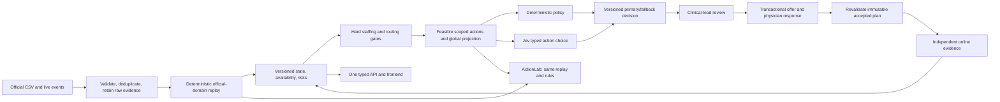

# Sevaro Sentinel engineering audit

Audit date: October 11, 2026. Repository: `belalezat1/RUHealthHacks`. Primary branches: `ray` and `frontend`; additional comparison: `ZaibKaukab/RUHealthHacks:frontend-zaib`.

This is an audit and integration recommendation. Implementation branches were preserved; no merge, deployment, or application-code changes were performed. Dependencies, databases, servers, and probes ran in isolated copies under `/tmp/sevaro-audit-20261011`. The working branch remains `belal`, at the same commit as `main`. Report artifacts are under `output/audit/2026-10-11`.

Evidence labels: **verified** means exercised locally; **observed** means supported by source; **inference** means an engineering assessment, not a demonstrated exploit or production result. Scores are judgment-based readiness estimates, not test coverage percentages or certifications. Source links pin the audited commit, so later branch changes will not change the evidence.

User steering incorporated: prioritize the backend now; defer visual redesign. The supplied blue-and-white dashboard image is a future style reference. Backend wiring remains essential; cosmetic UI work is not on the immediate critical path.

## A. Executive verdict

**The repository contains useful foundations, but no branch implements the complete Sentinel vision, and the latest `frontend` does not operate with Ray's backend. Neither is production-grade.**

What actually exists:

- **Ray:** a working FastAPI/PostgreSQL application, its own connected React frontend, two custom synthetic JSON datasets, live event ingestion, deterministic eligibility and forecasting, transaction-protected assignments, consent and separate activation verification, replay simulations, and a real TypeSafe adapter. All **70 backend tests pass**, and its own browser workflow passes. Its domain schema and staffing policy differ substantially from the official challenge.
- **Frontend / Zaib frontend:** polished Relay coverage desk and landing page backed by browser-local demo state. Both build. All **31 shared source files are byte-identical**, including the operational pages, styling, demo provider, and API client. Neither made any backend requests in the tested operational flow. Accepting an offer immediately announces restored coverage and reload loses the change.
- **Yassin:** the most useful implementation of the official CSV challenge. **29 tests pass**, including a **208-field reference snapshot match**, late-event replay, approval/send/accept/decline/expiry, acceptance races, and restart persistence. It has a working API contract and its own frontend. However, newly reproduced repeat-call and accepted-work accounting defects must be fixed before relying on its general behavior.
- **Backend branch:** official synthetic CSV data and dependency declarations, not an implemented backend.
- **Henry:** a deployment proposal, not a running service implementation.
- **Main / local Belal:** planning documents and an architecture image, not the integrated product.

The strongest engineering work is Ray's persistence, revalidation, bounded TypeSafe adapter, and verification separation, together with Yassin's official-domain replay, risk standards, routing, offer lifecycle, tests, and operational scripts. The main risks are disconnected UI behavior, challenge-incompatible Ray inputs and rules, Yassin's repeat-call accounting and incomplete rolling work history, and the absence of a Jev-primary decision policy and paired ActionLab evaluation.

**Recommended approach:** create a fresh integration branch from `main` after review. Establish Yassin's official-domain behavior and API as the initial vertical slice, fix its reproduced defects, bring in Ray's Jev adapter and persistence/revalidation patterns through deliberate ports, and wire one frontend to one contract. Do not mechanically merge whole applications. Section J gives the file-level map.

**Jev key:** root `.env` contains a usable `TYPESAFE_API_KEY`. A server-side live synthetic smoke request returned `jev-1.13.0` in **208.75 ms**. Its normalized result was **uncertain**, correctly surfaced rather than treated as permission to act. This verifies the key and native adapter path, not operational decision quality, a latency SLA, or Jev-primary application behavior. The value was never printed or included in artifacts. Root `.env` works with Ray's Compose environment interpolation; direct execution from `backend/` reads that directory's `.env`, so explicitly load/export the root environment when launching directly. See [ray/compose.yaml:13](https://github.com/belalezat1/RUHealthHacks/blob/ae6bdff862a57507b73d0a73e4d1a21112369fc6/compose.yaml#L13) and [ray/backend/app/core/config.py:13](https://github.com/belalezat1/RUHealthHacks/blob/ae6bdff862a57507b73d0a73e4d1a21112369fc6/backend/app/core/config.py#L13).

## B. Branch inventory

`origin/HEAD` points to `origin/main`. Remote inventory was refreshed with `git fetch --all --prune`; snapshots were then exported without checking out or merging teammates' branches. The additional Zaib branch was cloned separately on the user's request.

| Branch / audited commit | Purpose | Relevant features | Quality and evidence | Integration conflicts | Recommendation |
|---|---|---|---|---|---|
| `main` — `fb87fbd` | Initial product/build plan; 3 tracked files | README, BUILD-PLAN, architecture image | Useful intent, no executable application | Competing descendants redefine architecture and paths | Use as the clean integration base; update documents to the supplied Sentinel vision |
| local `belal` — `fb87fbd` | Current workspace branch | Same tracked tree as main; prior requested skill/env setup is untracked | No additional implementation | None beyond local untracked setup | Preserve workspace and credentials; no destructive checkout |
| `ray` — `ae6bdff` | Custom synthetic operations app; 112 tracked files | FastAPI, PostgreSQL/Alembic, eligibility, shared-capacity forecast, optimizer, Jev adapter, connected UI, replay, CI | 70 tests and 1 browser workflow pass; strong architectural foundation, poor exact challenge fit | Main→Ray diff: 111 files, +19,762/−88 lines; overlaps frontend entrypoints, package files and contracts | Retain infrastructure/adapter/revalidation patterns; adapt or replace challenge domain rather than claim compatibility |
| `frontend` — `b948eb9` | Latest Relay design; 72 tracked files | Landing, coverage desk, eligibility drawer, simulated offers and event lab | Build passes; active screens are mocks; test environment fails | Main→frontend: 71 files, +10,803/−16; 11 Ray/frontend conflict paths | Retain selected visual components later; replace operational state wiring now |
| `backend` — `daf4dbc` | Initial official data import; 14 tracked files | 9 challenge CSVs, requirements | Valuable reference input; no service/engine | Different data location from Yassin; no feature APIs | Keep an authoritative fixture set and source checksums, not another backend skeleton; [backend/backend/data/event_stream.csv:1](https://github.com/belalezat1/RUHealthHacks/blob/daf4dbc773faee66add34ddbf3267f42db839e38/backend/data/event_stream.csv#L1) |
| `henry` — `558cbc7` | Cloud deployment plan; 4 tracked files | App Runner / S3 proposal | Documentation only; describes an older in-memory direction | Conflicts conceptually with durable PostgreSQL and Yassin's EC2 deployment | Use rationale as historical context; do not treat as deployable infrastructure; [henry/CLOUD-DEPLOY.md:1](https://github.com/belalezat1/RUHealthHacks/blob/558cbc7915b9771629e17d4e7731058de5ce113a/CLOUD-DEPLOY.md#L1) |
| `yassin` — `29f0b60` | Official challenge implementation; 87 tracked files | Immutable CSV references, deterministic replay, snapshot verifier, stage risks, p90 coverage, routing trap guard, roles/CSRF/offers, SQLite persistence, deployment/backup/restart/load scripts | 29 tests pass; closest official-domain fit; defects Y1–Y6 below | Separate `backend/core` + `backend/api`, `/api/v1`, SQLite model and frontend entrypoints conflict with Ray's `/v1` stack | Import domain behavior and tests deliberately; fix defects, port persistence before pilot |
| `ZaibKaukab/...:frontend-zaib` — `68bb2c5` | External Relay design branch; 57 tracked files | Same operational screens and landing design as current team frontend | Build and manual browser flow pass as a mock; 31 shared source files identical | Same entrypoint/style/package collisions as team frontend; fewer legacy helper/test files | No integration or visual advantage over `b948eb9`; choose one source, avoid duplicating components |

There is no dependency between the deployed behavior of the two primary branches: `frontend` copied Ray's four API files (`client.ts`, `hooks.ts`, `types.ts`, `generated.ts`) exactly, but does not use them in its active operational screens. This is shared code, not verified integration. Yassin contributes an independent domain implementation, not a small enhancement that can be cherry-picked unchanged into Ray.

The read-only three-tree merge preview found conflicts in `.gitignore`, `README.md`, `frontend/README.md`, `frontend/index.html`, `frontend/package-lock.json`, `frontend/package.json`, `frontend/src/App.tsx`, `frontend/src/main.tsx`, `frontend/src/styles.css`, `frontend/tsconfig.json`, and `frontend/vite.config.ts`. A conflict-free resolution would still leave contradictory domain models and mock wiring. See [merge-conflicts.json](evidence/merge-conflicts.json) and [branches.json](evidence/branches.json).

## C. Requirements traceability

Sources, in order of relevance:

1. The user's [Sentinel research-reconciled PRD and build plan](</Users/b/Downloads/Sevaro Sentinel_ Research-Reconciled PRD and BUILD-PLAN.pdf>): the main product vision, including Jev-primary bounded decisions and ActionLab.
2. The newly supplied [Challenge 2 Handbook](/Users/b/Downloads/Sevaro/Challenge_2_Handbook.pdf): exact judging input and explicit repeat-call behavior, plus simplified rules and examples.
3. The official Challenge 2 brief and developer-kit README in Yassin's `references/`, together with official CSVs. [yassin/references/DEV_KIT_README.txt:16](https://github.com/belalezat1/RUHealthHacks/blob/29f0b6042f6ac86553c3d45edea22bb3926ff713/references/DEV_KIT_README.txt#L16)
4. Branch README/BUILD-PLAN, implementation contracts and assumptions. These describe older scope choices; they do not override the new vision or prove implementation.

**Handbook clarification materially changes the audit:** Chapter 4 says the judge injects **one event CSV with the same eight columns, doctors, hospitals and event kinds**, appending to the existing day. Consequently, Yassin's fixed reference IDs/date are not automatically a blocker for that narrowed judging input. Renamed hospitals and different dates remain broader product robustness gaps. Ray's rejection of official event CSVs remains a direct demo blocker. Chapter 5 explicitly requires a repeat call for the same `consult_id` to count as one patient and preserve the first waiting time; Yassin fails that reproduced case.

Licensing, pricing, real integrations and HIPAA considerations are extensions in Handbook Chapters 7–8. The challenge folds licensing into hospital credentialing. Do not invent missing license/expiry/cost data and reject every otherwise valid challenge candidate on that basis. Likewise, the handbook's simulated thresholds are not clinical standards.

| Requirement / source | Ray | Current frontend and Zaib | Yassin | Assessment |
|---|---|---|---|---|
| Official eight-column event CSV; append live without restart — handbook Ch. 4 | Custom JSON `availability` / `consultation.created` / `completed` / `activation`; official event rejected 422 | Free-text presets modify local mock state | CSV validation/import; tested live new records and revisions | Use Yassin semantics; R1, F1 |
| Match 18:20 reference snapshot; scenario time rather than wall clock — handbook Ch. 6 | Different datasets rebased to current time; no official snapshot match | Fixed display March 17, but no replay engine | 208 fields matched by tests | Verified only on Yassin; [yassin/backend/tests/test_api.py:71](https://github.com/belalezat1/RUHealthHacks/blob/29f0b6042f6ac86553c3d45edea22bb3926ff713/backend/tests/test_api.py#L71) |
| Event-time reconstruction, duplicate IDs, late input | Dedup/hash conflicts handled; equal-time availability is arrival-dependent | Duplicate preset becomes two log entries | Sorted replay and ID dedup pass | R2; repeat-call semantics separate from ID dedup |
| Repeat call with a new event ID, same consult: one demand arrival and original clock — handbook Ch. 2 issue 7 / Ch. 5 | Duplicate consultation entity rejected; no explicit retry-call domain | No patient retry model | `received_at` overwritten; arrival count increments twice | Y1 reproduced; must fix before judge injection |
| Separate consult stages and physician activity; several open consults per doctor | Assigned/active consults consume the single slot; no imaging/note lifecycle | Three simplified consult statuses | Independent replay records and official stage standards | Yassin is the appropriate domain starting point |
| Synapse busy, external camera, interruptible meeting, offline agent unverified | Generic heartbeat/self-report/activity; strict connectivity rules differ | Static demo labels | Official reconciliation implemented | Import [yassin/backend/core/replay.py:210](https://github.com/belalezat1/RUHealthHacks/blob/29f0b6042f6ac86553c3d45edea22bb3926ff713/backend/core/replay.py#L210), preserve provenance |
| Stage limits, stroke priority, retry every 5 min, low volume ≤6 day / ≤4 night | Generic urgent/routine deadlines and single-consult ranking | Hardcoded risks/next action | Stage standards and routing ordering implemented | Ray policy is not an implementation of exact official routing |
| Hospital-specific coverage blocks and trailing-hour p90 surge uplift | Constant hospital minimum and supplied work-arrival assumptions | Static six-bin horizon | Coverage blocks + observed/projected trailing demand + p90 uplift | Yassin implements official metric; Ray supplies useful global-capacity pattern |
| At least 90-minute forecast | Real deterministic six-bin work-minute allocation | Fixed bins, rounded into apparent physician counts | 19 five-minute samples with disclosed assumptions | Both backends are projections, not validated statistical forecasts |
| Off-shift willingness, credentials, 10h rest, rolling 7d ≤60h, overlap, offer ≥2h, ETA | No official opt-in/7d fields; defaults 2h rest and ≥15min activation | Mock eligibility | Initial checks implemented; accepted work omitted from rest/hours | R4 and Y2; ETA duration ambiguity below |
| Clinical-lead approval before simulated outreach; private physician reply | Dispatcher/admin approve; no distinct sent state | Same screen impersonates approval and physician acceptance | Coordinator/lead/physician separation and PHI-free notification | Retain Yassin lifecycle; R5/F2 |
| One open offer per physician; ≤3/week; 10min expiry; acceptance race | Multiple proposals per physician; five-minute proposal expiry; assignment race protection | No server ledger/timer/concurrency | Open-offer constraints, weekly counts, sent expiry and gap claims tested | Yassin closer; rolling history and real-time expiry need production work |
| Prevent split-shift routing trap | No official router/new-joiner policy | Claims both seeding and scoping, neither enforced operationally | Offer-scoped joiner guard; illustrative next-call comparisons | Y3/F4; full workload progression remains missing |
| Accepted plan distinct from confirmed online capacity — Sentinel | Separate commit and activation verification | Accept instantly removes risk/restores coverage | Planned capacity is labeled, counts from ETA; no independent confirmation gate | Ray pattern should be ported into official domain |
| Hard gates → feasible actions → **Jev primary** → lead → commit revalidation — Sentinel | Hard gates exist; Jev explicitly cannot reorder deterministic selection | No model call | No Jev integration | R7: central vision gap, not merely an optional polish item |
| ActionLab no-action / deterministic / naive split / scoped split / Jev, paired same-state comparison | Baseline vs greedy only, no live Jev; distinct replay ingestion | Event animation and preset text, no measured comparison | Trap illustration, not full paired 90-minute replay | Rebuild comparison runner using common event engine |
| Durable safe operational deployment — Sentinel | PostgreSQL foundation; hosted app not deployed according to branch docs | Browser state only; no production login | SQLite + EC2 deployment assets and hosted verification notes | Audit did not verify AWS; no compliance or production safety established |

**ETA/minimum-duration ambiguity:** the explicit rule says offered shift ≥2h and ETA reduces benefit. Handbook issue 8 also gives an example in which time-to-online makes the offer worth under 2h. Yassin offers exactly 2h and reports only 105 useful minutes for a 15-minute ETA. Resolve whether judges require two offered hours or two useful coverage hours; make both quantities visible. Until clarified, generate an offer long enough for two useful hours where scheduling/rest/hours permit. This is a conservative implementation recommendation, not a claim that the explicit brief already defines a 120-minute net-coverage hard gate. [yassin/backend/core/staffing.py:96](https://github.com/belalezat1/RUHealthHacks/blob/29f0b6042f6ac86553c3d45edea22bb3926ff713/backend/core/staffing.py#L96)

## D. Ray technical review

### Verified strengths

Schema validation is strict about unknown fields, IDs, time awareness, references and bounded uploads. Dataset activation is atomic. Raw event IDs and semantic hashes distinguish duplicate versus conflicting payloads. PostgreSQL migrations run successfully, mutations lock shared state, and partial unique indexes prevent simultaneous active assignment of the same physician/consultation. Tests exercise authorization, scope, stale versions, idempotency and concurrent assignment. [ray/backend/app/schemas/events.py:79](https://github.com/belalezat1/RUHealthHacks/blob/ae6bdff862a57507b73d0a73e4d1a21112369fc6/backend/app/schemas/events.py#L79) [ray/backend/app/services/datasets.py:74](https://github.com/belalezat1/RUHealthHacks/blob/ae6bdff862a57507b73d0a73e4d1a21112369fc6/backend/app/services/datasets.py#L74) [ray/backend/app/services/ingestion.py:16](https://github.com/belalezat1/RUHealthHacks/blob/ae6bdff862a57507b73d0a73e4d1a21112369fc6/backend/app/services/ingestion.py#L16) [ray/backend/app/models.py:89](https://github.com/belalezat1/RUHealthHacks/blob/ae6bdff862a57507b73d0a73e4d1a21112369fc6/backend/app/models.py#L89)

Forecasting is computed from data: demand/backlog, qualified physicians, scheduled shifts, one-minute global allocation, urgent deadlines, and remaining work. A physician minute cannot be independently spent in every hospital. The implementation explicitly warns that recurring bin backlog should not be summed into unique patient demand. That transparency is valuable. [ray/backend/app/services/forecast.py:8](https://github.com/belalezat1/RUHealthHacks/blob/ae6bdff862a57507b73d0a73e4d1a21112369fc6/backend/app/services/forecast.py#L8) [ray/backend/app/services/forecast.py:141](https://github.com/belalezat1/RUHealthHacks/blob/ae6bdff862a57507b73d0a73e4d1a21112369fc6/backend/app/services/forecast.py#L141)

Approval and commit recheck eligibility against current state; physician responses require the corresponding physician identity. Verification requires a separate, fresh activation event after assignment and checks remaining coverage rather than declaring the whole hospital solved. Live Jev HTTP runs outside the database transaction. [ray/backend/app/services/decisions.py:104](https://github.com/belalezat1/RUHealthHacks/blob/ae6bdff862a57507b73d0a73e4d1a21112369fc6/backend/app/services/decisions.py#L104) [ray/backend/app/services/decisions.py:178](https://github.com/belalezat1/RUHealthHacks/blob/ae6bdff862a57507b73d0a73e4d1a21112369fc6/backend/app/services/decisions.py#L178) [ray/backend/app/api/recommendations.py:30](https://github.com/belalezat1/RUHealthHacks/blob/ae6bdff862a57507b73d0a73e4d1a21112369fc6/backend/app/api/recommendations.py#L30)

### Findings

**R1 — P0 for official demo: no challenge input adapter or consult lifecycle.** The only accepted dataset is `synthetic_v1` JSON with invented jurisdiction/specialty/license-expiry fields and `max_concurrent=1`. Live events use a different envelope and event vocabulary. An official-shaped event was rejected with 422; an official-shaped dataset validation returned `valid=false`. There is no reconstruction of the official triage/imaging/video/note progression or 18:20 snapshots. Supporting a second custom JSON dataset does not prove challenge compatibility. [ray/backend/app/schemas/events.py:20](https://github.com/belalezat1/RUHealthHacks/blob/ae6bdff862a57507b73d0a73e4d1a21112369fc6/backend/app/schemas/events.py#L20) [ray/backend/app/schemas/events.py:60](https://github.com/belalezat1/RUHealthHacks/blob/ae6bdff862a57507b73d0a73e4d1a21112369fc6/backend/app/schemas/events.py#L60) [ray/backend/app/schemas/events.py:79](https://github.com/belalezat1/RUHealthHacks/blob/ae6bdff862a57507b73d0a73e4d1a21112369fc6/backend/app/schemas/events.py#L79) [ray/backend/app/schemas/events.py:110](https://github.com/belalezat1/RUHealthHacks/blob/ae6bdff862a57507b73d0a73e4d1a21112369fc6/backend/app/schemas/events.py#L110)

**R2 — P1 data integrity: equal-time contradictory signals depend on arrival order.** Without a source sequence, ingestion treats `observed_at <= latest observed_at` as late and does not apply the second signal. Sending connected then disconnected versus the reverse produced different availability (`off_shift_available/connected=true` versus `disconnected/false`). The first order exposed no conflict. Raw preservation is good, but materialized availability is not deterministic for this case. Reconcile ties through an explicit stable policy or mark ambiguity; test both arrival orders. [ray/backend/app/services/ingestion.py:53](https://github.com/belalezat1/RUHealthHacks/blob/ae6bdff862a57507b73d0a73e4d1a21112369fc6/backend/app/services/ingestion.py#L53) [ray/backend/app/services/availability.py:17](https://github.com/belalezat1/RUHealthHacks/blob/ae6bdff862a57507b73d0a73e4d1a21112369fc6/backend/app/services/availability.py#L17) [Probe evidence](evidence/ray-probes.json).

**R3 — P1 semantic validation: invalid kind/value pairs accepted.** A `heartbeat` with value `available` returned 200. The schema independently validates broad enums without enforcing the meaningful combinations for heartbeat, self-report, activity and activation. An allowed but uninterpretable signal can distort freshness/conflict handling. Introduce discriminated signal schemas; quarantine malformed combinations atomically. [ray/backend/app/schemas/events.py:50](https://github.com/belalezat1/RUHealthHacks/blob/ae6bdff862a57507b73d0a73e4d1a21112369fc6/backend/app/schemas/events.py#L50) [ray/backend/app/services/availability.py:53](https://github.com/belalezat1/RUHealthHacks/blob/ae6bdff862a57507b73d0a73e4d1a21112369fc6/backend/app/services/availability.py#L53)

**R4 — P0 if used as official split-shift policy: hard gates are different.** The demo policy permits 120-minute rest and ≥15-minute activation, enforces rolling 24h/continuous limits instead of challenge rolling 7d ≤60h, and has no real off-shift opt-in, ETA or weekly offer ledger. The runtime selected a **25-minute activation**. This is coherent for its declared custom demo policy, but cannot be presented as the challenge's safe split shift. Required licenses/privilege expiry also reject data the kit never supplies. Keep production credential extensions separate from challenge credential checks. [ray/config/demo_policies.json:1](https://github.com/belalezat1/RUHealthHacks/blob/ae6bdff862a57507b73d0a73e4d1a21112369fc6/config/demo_policies.json#L1) [ray/backend/app/services/eligibility.py:243](https://github.com/belalezat1/RUHealthHacks/blob/ae6bdff862a57507b73d0a73e4d1a21112369fc6/backend/app/services/eligibility.py#L243) [ray/backend/app/services/eligibility.py:264](https://github.com/belalezat1/RUHealthHacks/blob/ae6bdff862a57507b73d0a73e4d1a21112369fc6/backend/app/services/eligibility.py#L264)

**R5 — P0 for consequential workflow: approval is not restricted to clinical lead; offer lifecycle is incomplete.** A dispatcher successfully approved. Non-physician transitions admit dispatcher/admin; there is no clinical-lead role or explicit sent/outreach state. Proposals expire after five minutes rather than ten minutes after sending. Two previews with different idempotency keys created two proposed offers for the same doctor. Assignment uniqueness protects the eventual assignment, not the required one-open-offer ledger. [ray/backend/app/core/security.py:37](https://github.com/belalezat1/RUHealthHacks/blob/ae6bdff862a57507b73d0a73e4d1a21112369fc6/backend/app/core/security.py#L37) [ray/backend/app/services/decisions.py:36](https://github.com/belalezat1/RUHealthHacks/blob/ae6bdff862a57507b73d0a73e4d1a21112369fc6/backend/app/services/decisions.py#L36) [ray/backend/app/services/decisions.py:118](https://github.com/belalezat1/RUHealthHacks/blob/ae6bdff862a57507b73d0a73e4d1a21112369fc6/backend/app/services/decisions.py#L118) [Probe evidence](evidence/ray-probes.json).

**R6 — P1 consent integrity: the approved/accepted interval is not fixed.** During later transition evaluation, start is recomputed from `max(now, candidate start)` with the same duration; consent records do not bind an exact approved offer interval. A delayed commit can therefore act on a different interval without fresh physician agreement. Revalidation should reject or reoffer a changed interval, while retaining evidence of exactly what lead and physician accepted. This is observed from code; no real physician communication was attempted. [ray/backend/app/services/decisions.py:127](https://github.com/belalezat1/RUHealthHacks/blob/ae6bdff862a57507b73d0a73e4d1a21112369fc6/backend/app/services/decisions.py#L127) [ray/backend/app/services/decisions.py:144](https://github.com/belalezat1/RUHealthHacks/blob/ae6bdff862a57507b73d0a73e4d1a21112369fc6/backend/app/services/decisions.py#L144)

**R7 — P1 product vision: Jev is advisory, not the primary choice.** The adapter implements the current native `POST /v1/systemone` contract, typed question/answer validation, uncertain/unavailable/invalid states, a bounded total timeout and no silent mock replacement. But advisory instructions explicitly prohibit reordering deterministic selection, and persistence attaches advice without changing the chosen candidate. Default budget is five seconds with one retry, versus the Sentinel proposal's 900ms hard deadline, parallel deterministic fallback, no synchronous retries and circuit breaker. Default mode is mock. The live smoke confirms credentials and typed responses only. [ray/backend/app/services/advisory.py:22](https://github.com/belalezat1/RUHealthHacks/blob/ae6bdff862a57507b73d0a73e4d1a21112369fc6/backend/app/services/advisory.py#L22) [ray/backend/app/services/advisory.py:57](https://github.com/belalezat1/RUHealthHacks/blob/ae6bdff862a57507b73d0a73e4d1a21112369fc6/backend/app/services/advisory.py#L57) [ray/backend/app/api/recommendations.py:31](https://github.com/belalezat1/RUHealthHacks/blob/ae6bdff862a57507b73d0a73e4d1a21112369fc6/backend/app/api/recommendations.py#L31) [ray/backend/app/integrations/jev.py:95](https://github.com/belalezat1/RUHealthHacks/blob/ae6bdff862a57507b73d0a73e4d1a21112369fc6/backend/app/integrations/jev.py#L95) [ray/backend/app/core/config.py:21](https://github.com/belalezat1/RUHealthHacks/blob/ae6bdff862a57507b73d0a73e4d1a21112369fc6/backend/app/core/config.py#L21). Current endpoint/criteria/response shape was checked against the [TypeSafe API reference](https://docs.typesafe.ai/api).

Jev should choose among uniquely identified, already feasible **actions**, not adjudicate numeric rest, licenses, authorization or staffing limits. The current shortlist is keyed by physician ID and capped at four; this is insufficient when one physician has multiple distinct safe actions. Include a defer/no-action alternative, state/rubric versions, full bounded candidate evidence and a deterministic result ready in parallel. Provider confidence measures distribution concentration, not clinical correctness; calibrate thresholds using representative labeled outcomes. The PDF's 0.75 is provisional. [ray/backend/app/services/advisory.py:22](https://github.com/belalezat1/RUHealthHacks/blob/ae6bdff862a57507b73d0a73e4d1a21112369fc6/backend/app/services/advisory.py#L22) [ray/backend/app/services/advisory.py:64](https://github.com/belalezat1/RUHealthHacks/blob/ae6bdff862a57507b73d0a73e4d1a21112369fc6/backend/app/services/advisory.py#L64) [TypeSafe confidence documentation](https://docs.typesafe.ai/confidence).

**R8 — P1 optimizer scope: CP-SAT solves one selection, not the envisioned network action problem.** Candidates are precomputed for a single waiting consultation and truncated to the first 64 sorted physicians. Delay score is the same for every candidate, not actual ETA. CP-SAT selects one Boolean candidate with minimum precomputed weighted cost; it does not generate or compare a bundle of interventions across urgent cases, hospital gaps and scoped shifts. New downstream critical risks become warning text rather than necessarily excluding the intervention. Use a declared lexicographic objective and hard downstream-capacity guards; do not market this as a globally optimized staffing schedule. [ray/backend/app/services/optimizer.py:24](https://github.com/belalezat1/RUHealthHacks/blob/ae6bdff862a57507b73d0a73e4d1a21112369fc6/backend/app/services/optimizer.py#L24) [ray/backend/app/services/optimizer.py:69](https://github.com/belalezat1/RUHealthHacks/blob/ae6bdff862a57507b73d0a73e4d1a21112369fc6/backend/app/services/optimizer.py#L69) [ray/backend/app/services/optimizer.py:109](https://github.com/belalezat1/RUHealthHacks/blob/ae6bdff862a57507b73d0a73e4d1a21112369fc6/backend/app/services/optimizer.py#L109).

**R9 — P1 forecast semantics differ from the challenge.** Computed six-bin values are qualified **work minutes/backlog** using constant supplied arrival assumptions and fixed hospital minimums. They are not the official available physician count per coverage block or a p90-calibrated surge forecast. Generic `active_work` treats every assigned/active consult as occupied, including work that the official lifecycle considers interruptible. No statistical forecast validation or uncertainty calibration is shown. Preserve global shared-resource accounting while porting official availability and demand rules; label assumptions and units. [ray/backend/app/services/forecast.py:19](https://github.com/belalezat1/RUHealthHacks/blob/ae6bdff862a57507b73d0a73e4d1a21112369fc6/backend/app/services/forecast.py#L19) [ray/backend/app/services/forecast.py:49](https://github.com/belalezat1/RUHealthHacks/blob/ae6bdff862a57507b73d0a73e4d1a21112369fc6/backend/app/services/forecast.py#L49) [ray/backend/app/services/availability.py:22](https://github.com/belalezat1/RUHealthHacks/blob/ae6bdff862a57507b73d0a73e4d1a21112369fc6/backend/app/services/availability.py#L22).

**R10 — P1 ActionLab validity: simulation is a useful harness, but not the primary workflow or required comparison.** It runs baseline versus greedy, not Jev/CP-SAT/scoped/naive/no-action policies. Its `_apply` event path differs from production ingestion, lacks conflicting-payload semantics, and can append duplicate consultation entities. It auto-generates synthetic consent/activation and completes work at expected end times. These are disclosed simulation assumptions, not evidence of real outreach or online behavior. The API replaces metadata `advisory_mode` with the configured mode even though replay makes no external calls; retain separate configured and actually-used model fields. [ray/backend/app/simulation/replay.py:18](https://github.com/belalezat1/RUHealthHacks/blob/ae6bdff862a57507b73d0a73e4d1a21112369fc6/backend/app/simulation/replay.py#L18) [ray/backend/app/simulation/replay.py:95](https://github.com/belalezat1/RUHealthHacks/blob/ae6bdff862a57507b73d0a73e4d1a21112369fc6/backend/app/simulation/replay.py#L95) [ray/backend/app/simulation/replay.py:144](https://github.com/belalezat1/RUHealthHacks/blob/ae6bdff862a57507b73d0a73e4d1a21112369fc6/backend/app/simulation/replay.py#L144) [ray/backend/app/api/simulations.py:41](https://github.com/belalezat1/RUHealthHacks/blob/ae6bdff862a57507b73d0a73e4d1a21112369fc6/backend/app/api/simulations.py#L41).

Metric definitions explicitly include unresolved waits right-censored at run end, but the percentile is the percentile of capped observed durations, not a survival estimate or a validated operational wait-time prediction. The integrated first-bin unmet-work measure also differs from official deficit physician-minutes. Report these definitions rather than equating measures across branches. [ray/backend/app/simulation/metrics.py:8](https://github.com/belalezat1/RUHealthHacks/blob/ae6bdff862a57507b73d0a73e4d1a21112369fc6/backend/app/simulation/metrics.py#L8).

**R11 — P2 production security/operations:** Cognito access-token verification, issuer/client validation, signed group/scope mapping and production rejection of demo actors are valuable. The browser client only sends forgeable local demo headers and has no hosted login/token flow. HTTP role rejection in demo tests is not proof of trusted real identities. Audit records are application-appended JSON rows, not tamper-evident records with independently enforced retention. Broad metadata/notes can enter datasets and Jev state; a synthetic flag is not PHI filtering. Before real data: minimal provider payloads, access review, credentials lifecycle, telemetry redaction, authenticated UI and protected audit retention. [ray/backend/app/core/security.py:41](https://github.com/belalezat1/RUHealthHacks/blob/ae6bdff862a57507b73d0a73e4d1a21112369fc6/backend/app/core/security.py#L41) [ray/backend/app/models.py:102](https://github.com/belalezat1/RUHealthHacks/blob/ae6bdff862a57507b73d0a73e4d1a21112369fc6/backend/app/models.py#L102) [ray/frontend/src/api/client.ts:51](https://github.com/belalezat1/RUHealthHacks/blob/ae6bdff862a57507b73d0a73e4d1a21112369fc6/frontend/src/api/client.ts#L51) [ray/backend/app/services/advisory.py:22](https://github.com/belalezat1/RUHealthHacks/blob/ae6bdff862a57507b73d0a73e4d1a21112369fc6/backend/app/services/advisory.py#L22).

**R12 — P2 deployment/scaling:** global `ActiveState` locking provides a simple concurrency boundary but serializes mutations; polling recomputes forecasts and dashboard reads copy the materialized state. Current measurements are small-fixture serial results, not throughput proof. Branch deployment notes explicitly say AWS foundation resources exist but no backend service/image, frontend assets or application schema are deployed, and private routes lack external egress. Live Jev needs an approved outbound route; reconcile that before an ECS release. Documentation and screenshots were inspected; AWS resources were not queried or changed in this audit. Container builds were not verified because Docker's daemon was unavailable. [ray/backend/app/core/database.py:20](https://github.com/belalezat1/RUHealthHacks/blob/ae6bdff862a57507b73d0a73e4d1a21112369fc6/backend/app/core/database.py#L20) [ray/backend/app/services/datasets.py:110](https://github.com/belalezat1/RUHealthHacks/blob/ae6bdff862a57507b73d0a73e4d1a21112369fc6/backend/app/services/datasets.py#L110) [ray/docs/deployment.md:1](https://github.com/belalezat1/RUHealthHacks/blob/ae6bdff862a57507b73d0a73e4d1a21112369fc6/docs/deployment.md#L1).

### Other backend findings: Yassin

**Y1 — P0 for the new handbook: repeat call corrupts demand and received-time waiting.** `consult_received` uses `setdefault` to preserve one consult object, then unconditionally replaces `received_at` and appends another hospital arrival. A probe with the same consult received at 18:05 and called again at 18:12 produced **one consult, two demand arrivals and eight minutes since receipt at 18:20**, instead of one demand arrival and 15 minutes. Existing later-stage clocks may remain preserved; the reproduced error specifically affects receipt time and demand counting. Deduplicate real-world retries by explicit `consult_id`, retaining earliest valid receipt and retry evidence, without merging different patients at the same hospital. [yassin/backend/core/replay.py:119](https://github.com/belalezat1/RUHealthHacks/blob/29f0b6042f6ac86553c3d45edea22bb3926ff713/backend/core/replay.py#L119) [Probe evidence](evidence/yassin-probes.json).

**Y2 — P0 for staffing safety: already accepted work is omitted from hours/rest.** Eligibility uses static roster `last_shift_end` and `hours_worked_7d + this offer`; accepted commitments are checked only for overlap. In a constructed ledger with 58 source hours, a prior two-hour accepted commitment and a new two-hour offer, it returned eligible and reported 60h although the incremental total is 62h. It reported 16h rest since the roster shift although the preceding accepted commitment ended two hours before. This is a focused pure-function counterexample, not a claim that the original fixture already violates its limit. Merge baseline history and incremental actual/committed work without double counting; revalidate in the same acceptance transaction. [yassin/backend/core/staffing.py:82](https://github.com/belalezat1/RUHealthHacks/blob/29f0b6042f6ac86553c3d45edea22bb3926ff713/backend/core/staffing.py#L82) [yassin/backend/core/staffing.py:89](https://github.com/belalezat1/RUHealthHacks/blob/29f0b6042f6ac86553c3d45edea22bb3926ff713/backend/core/staffing.py#L89) [yassin/backend/core/staffing.py:99](https://github.com/belalezat1/RUHealthHacks/blob/29f0b6042f6ac86553c3d45edea22bb3926ff713/backend/core/staffing.py#L99) [yassin/backend/api/service.py:127](https://github.com/belalezat1/RUHealthHacks/blob/29f0b6042f6ac86553c3d45edea22bb3926ff713/backend/api/service.py#L127).

**Y3 — P1 post-joiner routing:** accepted joiners are assumed routable once ETA passes, with count always reset to zero and no current busy/ringing/cooldown checks in that branch. Scoping prevents out-of-scope capture but does not establish workload progression or availability after the first routed call. Its trap comparison is an illustrative next-call calculation, not a dynamic 90-minute routing simulation. Carry observed consult counts and availability into accepted joiners; separate planned ETA from online confirmation. [yassin/backend/core/routing.py:30](https://github.com/belalezat1/RUHealthHacks/blob/29f0b6042f6ac86553c3d45edea22bb3926ff713/backend/core/routing.py#L30) [yassin/backend/core/routing.py:70](https://github.com/belalezat1/RUHealthHacks/blob/29f0b6042f6ac86553c3d45edea22bb3926ff713/backend/core/routing.py#L70).

**Y4 — P1 vision / P2 beyond narrowed judge file: fixed reference assumptions.** Renaming every hospital from `SYN-*` to `HOSP-*` without changing CSV schemas yielded 12 hospitals and **zero credential edges**, because the loader only accepts credential columns beginning `SYN-`. Schedules, supported event times and weekday baselines are anchored to March 17. New-day same-schema events are rejected. Reference tables load at startup; the live endpoint adds events, not a whole new hospital/roster package. The handbook's same-ID, same-day injection means these are broader product gaps, not a reason to dismiss Yassin's valid judge-file path. [yassin/backend/core/data.py:16](https://github.com/belalezat1/RUHealthHacks/blob/29f0b6042f6ac86553c3d45edea22bb3926ff713/backend/core/data.py#L16) [yassin/backend/core/data.py:125](https://github.com/belalezat1/RUHealthHacks/blob/29f0b6042f6ac86553c3d45edea22bb3926ff713/backend/core/data.py#L125) [yassin/backend/core/data.py:181](https://github.com/belalezat1/RUHealthHacks/blob/29f0b6042f6ac86553c3d45edea22bb3926ff713/backend/core/data.py#L181) [yassin/backend/core/events.py:125](https://github.com/belalezat1/RUHealthHacks/blob/29f0b6042f6ac86553c3d45edea22bb3926ff713/backend/core/events.py#L125).

**Y5 — P1 request integrity:** idempotency validates username/key and route, but not the body hash. Reusing one key for `/clock` with `minutes=1` and then `minutes=30` returned 200 and replayed the original result. A changed payload should return a conflict, while byte-equivalent retries should replay. Include run identity, canonical payload hash and identity/action in the receipt. [yassin/backend/api/service.py:161](https://github.com/belalezat1/RUHealthHacks/blob/29f0b6042f6ac86553c3d45edea22bb3926ff713/backend/api/service.py#L161) [Probe evidence](evidence/yassin-probes.json).

**Y6 — P1 projection boundary / P2 production:** per-hospital available counts deliberately count a multi-credentialed doctor at each hospital; the source warns not to sum them as network capacity. Accepted capacity counts from ETA without an independent activation gate. This is a disclosed hospital-access measure, not proof of simultaneous network supply. Add global allocation and independent activation before treating network gaps as closed. Offer expiry uses scenario time, which is appropriate for the supplied replay day but not unattended wall-clock production expiry. SQLite/RLock/`BEGIN IMMEDIATE`, single-node EC2 and shared demo-password identities are a bounded demo architecture, not a multi-instance pilot architecture. [yassin/backend/core/coverage.py:15](https://github.com/belalezat1/RUHealthHacks/blob/29f0b6042f6ac86553c3d45edea22bb3926ff713/backend/core/coverage.py#L15) [yassin/backend/core/coverage.py:79](https://github.com/belalezat1/RUHealthHacks/blob/29f0b6042f6ac86553c3d45edea22bb3926ff713/backend/core/coverage.py#L79) [yassin/backend/api/service.py:148](https://github.com/belalezat1/RUHealthHacks/blob/29f0b6042f6ac86553c3d45edea22bb3926ff713/backend/api/service.py#L148) [yassin/backend/api/store.py:203](https://github.com/belalezat1/RUHealthHacks/blob/29f0b6042f6ac86553c3d45edea22bb3926ff713/backend/api/store.py#L203) [yassin/backend/api/config.py:33](https://github.com/belalezat1/RUHealthHacks/blob/29f0b6042f6ac86553c3d45edea22bb3926ff713/backend/api/config.py#L33).

Yassin's security positives should be retained: distinct coordinator/clinical lead/physician permissions, authenticated sessions, CSRF and expected revision/run headers, private physician offer projection, transaction-protected gap claims, explicit sent expiry, PHI-free notification text and backup/restart tooling. These are tested locally on synthetic inputs; deployed AWS/CloudFront claims in branch notes are not independently verified here. [yassin/backend/tests/test_api.py:52](https://github.com/belalezat1/RUHealthHacks/blob/29f0b6042f6ac86553c3d45edea22bb3926ff713/backend/tests/test_api.py#L52) [yassin/backend/tests/test_api.py:86](https://github.com/belalezat1/RUHealthHacks/blob/29f0b6042f6ac86553c3d45edea22bb3926ff713/backend/tests/test_api.py#L86) [yassin/.github/workflows/ci.yml:1](https://github.com/belalezat1/RUHealthHacks/blob/29f0b6042f6ac86553c3d45edea22bb3926ff713/.github/workflows/ci.yml#L1).

## E. Frontend technical review and Zaib comparison

UI review is intentionally bounded following the user's backend-first direction. Correct operational wiring remains P0; visual redesign is deferred.

**F1 — P0 integration: active application always uses DemoProvider.** `main.tsx` wraps the app in browser-local demo state. Desk/Lab consume `useDemo`; no active operational query calls Ray or Yassin. The copied Ray API client and three-second dashboard hook are unused here. Manual browser runs at desktop and mobile found **zero `/v1/` or `/api/` requests** during load, approve/send/accept and injection. `VITE_API_MODE` / `VITE_REPORT_ENDPOINT` in the example environment do not switch these screens to live behavior. [frontend/frontend/src/main.tsx:21](https://github.com/belalezat1/RUHealthHacks/blob/b948eb95c7b43fecc3e95c199447bd423a7ed430/frontend/src/main.tsx#L21) [frontend/frontend/src/demo/store.tsx:51](https://github.com/belalezat1/RUHealthHacks/blob/b948eb95c7b43fecc3e95c199447bd423a7ed430/frontend/src/demo/store.tsx#L51) [frontend/frontend/src/pages/Desk.tsx:18](https://github.com/belalezat1/RUHealthHacks/blob/b948eb95c7b43fecc3e95c199447bd423a7ed430/frontend/src/pages/Desk.tsx#L18) [frontend/frontend/src/api/hooks.ts:3](https://github.com/belalezat1/RUHealthHacks/blob/b948eb95c7b43fecc3e95c199447bd423a7ed430/frontend/src/api/hooks.ts#L3).

**F2 — P0 false outcome:** approve/send/accept are local setters, not server-authorized transitions. Acceptance immediately changes an off-shift doctor to on-shift/available, removes a risk, assigns a fixed consult and increments capacity in future bins. The UI announces “Coverage restored at Riverfront” without ETA, commit-time revalidation or online evidence; reload loses the result. No real offer expiry or concurrency ledger exists. These are simulation behaviors, but would be unsafe if reused as authoritative live state. [frontend/frontend/src/demo/store.tsx:113](https://github.com/belalezat1/RUHealthHacks/blob/b948eb95c7b43fecc3e95c199447bd423a7ed430/frontend/src/demo/store.tsx#L113) [frontend/frontend/src/demo/store.tsx:145](https://github.com/belalezat1/RUHealthHacks/blob/b948eb95c7b43fecc3e95c199447bd423a7ed430/frontend/src/demo/store.tsx#L145) [frontend/frontend/src/pages/Desk.tsx:54](https://github.com/belalezat1/RUHealthHacks/blob/b948eb95c7b43fecc3e95c199447bd423a7ed430/frontend/src/pages/Desk.tsx#L54).

**F3 — P1 state/units:** horizon divides work-minute demand/capacity by 15 and rounds them into an apparent available/required physician ratio; even zero demand is clamped to required=1. This does not mean the official staffing minimum or real physician count. Eligibility renders unknown checks as Fail and tests `eligible` before `unverified` in outcome substrings, which can mislabel a combined eligibility/unverified value. Unverified physicians have the same “available” pill with a small footnote. Preserve unknown/unverified distinctly and use explicit typed units, planned capacity and confirmed supply. [frontend/frontend/src/components/CoverageHorizon.tsx:9](https://github.com/belalezat1/RUHealthHacks/blob/b948eb95c7b43fecc3e95c199447bd423a7ed430/frontend/src/components/CoverageHorizon.tsx#L9) [frontend/frontend/src/components/EligibilityMatrix.tsx:24](https://github.com/belalezat1/RUHealthHacks/blob/b948eb95c7b43fecc3e95c199447bd423a7ed430/frontend/src/components/EligibilityMatrix.tsx#L24) [frontend/frontend/src/components/EligibilityMatrix.tsx:36](https://github.com/belalezat1/RUHealthHacks/blob/b948eb95c7b43fecc3e95c199447bd423a7ed430/frontend/src/components/EligibilityMatrix.tsx#L36) [frontend/frontend/src/pages/Desk.tsx:174](https://github.com/belalezat1/RUHealthHacks/blob/b948eb95c7b43fecc3e95c199447bd423a7ed430/frontend/src/pages/Desk.tsx#L174).

**F4 — P1 misleading lab/trap claims:** injecting preset strings increments local event count and mutates one fixed hospital, not schema-validated replay. The duplicate preset injected twice appears twice. Text says workload is seeded and offers scoped, but there is no active operational router. This cannot demonstrate live judge CSV behavior or measured ActionLab results. [frontend/frontend/src/demo/store.tsx:75](https://github.com/belalezat1/RUHealthHacks/blob/b948eb95c7b43fecc3e95c199447bd423a7ed430/frontend/src/demo/store.tsx#L75) [frontend/frontend/src/pages/Lab.tsx:13](https://github.com/belalezat1/RUHealthHacks/blob/b948eb95c7b43fecc3e95c199447bd423a7ed430/frontend/src/pages/Lab.tsx#L13) [frontend/frontend/src/components/EligibilityMatrix.tsx:89](https://github.com/belalezat1/RUHealthHacks/blob/b948eb95c7b43fecc3e95c199447bd423a7ed430/frontend/src/components/EligibilityMatrix.tsx#L89).

**F5 — P1 integration errors/loading:** because screens always have fixtures, there is no exercised live loading, empty-data, expired forecast, disconnected transport or stale-revision recovery path. The dormant Ray client expects `{detail}` errors and demo-header auth; the older root `api.ts` expects run/revision values in the JSON body and cookies/CSRF. Yassin requires run/revision headers and `{error:{code,message,...}}`. Picking a URL is insufficient; choose a single contract. [frontend/frontend/src/api/client.ts:71](https://github.com/belalezat1/RUHealthHacks/blob/b948eb95c7b43fecc3e95c199447bd423a7ed430/frontend/src/api/client.ts#L71) [frontend/frontend/src/api.ts:13](https://github.com/belalezat1/RUHealthHacks/blob/b948eb95c7b43fecc3e95c199447bd423a7ed430/frontend/src/api.ts#L13).

**F6 — P2 accessibility/mobile:** desktop hierarchy puts a clear problem, reason and next action first, with readable cards and a calm palette. At 390px width there was no horizontal overflow, but the risk heading and CTA share too little width: the heading becomes a long stack of short lines. Modal focus stays on the opener and Escape does not close it; declaring `role=dialog` does not implement keyboard behavior. Full contrast, screen-reader and WCAG conformance were not tested. [frontend/frontend/src/pages/Desk.tsx:217](https://github.com/belalezat1/RUHealthHacks/blob/b948eb95c7b43fecc3e95c199447bd423a7ed430/frontend/src/pages/Desk.tsx#L217) [Mobile capture](evidence/zaib-mobile-top.png).

**F7 — P2 verification/tooling:** `npm run build` and embedded TypeScript checks pass, but `npx vitest run` fails before tests because `jsdom` is absent; test setup also imports an undeclared `@testing-library/jest-dom/vitest`. No test script is supplied. Dependency audits report three high-severity package findings in Ray/current/Zaib and two findings in Yassin (one high/one moderate); applicability is discussed in H, not treated as a demonstrated exploit. Compiled `dist/` is committed on the current frontend, creating stale-artifact risk. [frontend/frontend/package.json:1](https://github.com/belalezat1/RUHealthHacks/blob/b948eb95c7b43fecc3e95c199447bd423a7ed430/frontend/package.json#L1) [frontend/frontend/src/test-setup.ts:1](https://github.com/belalezat1/RUHealthHacks/blob/b948eb95c7b43fecc3e95c199447bd423a7ed430/frontend/src/test-setup.ts#L1) [frontend/frontend/vitest.config.ts:1](https://github.com/belalezat1/RUHealthHacks/blob/b948eb95c7b43fecc3e95c199447bd423a7ed430/frontend/vitest.config.ts#L1).

### Which frontend is better?

| Question | Current `frontend` | Zaib `frontend-zaib` | Ray's own frontend |
|---|---|---|---|
| Backend integrated? | No in tested active screens | No in tested active screens | Yes with its own backend; browser workflow verified |
| Operational source/design | Same 31 shared source files | Same 31 shared source files | Different, detailed command-center pages |
| Visual appeal, desktop | Polished dark Relay design | Tie: same layout, colors, assets/code in shared experience | More information-dense and less presentation-led; clearer evidence/workflow detail |
| Mobile | No horizontal overflow; cramped top risk card | Same issue | Full mobile comparison not performed |
| Test/tooling differences | Extra dormant legacy helper/test files; broken test dependencies | Leaner frontend package, no comparable test suite | Connected E2E test, generated contract, format/type checks |
| Recommendation now | Preserve one design source, replace demo wiring | No reason to import duplicate runtime files | Retain behavior/evidence patterns, adapt to official domain |

**Conclusion:** there is no evidence-based reason to call Zaib's shared frontend better integrated or more visually appealing than the current team frontend; they are effectively the same design. The hero animation differs between screenshots because of runtime animation state, not a source-design improvement. Shared entrypoint evidence: [zaib/frontend/src/main.tsx:21](https://github.com/ZaibKaukab/RUHealthHacks/blob/68bb2c524ed708aa6bfea12b1883912007997303/frontend/src/main.tsx#L21) and [zaib/frontend/src/demo/store.tsx:51](https://github.com/ZaibKaukab/RUHealthHacks/blob/68bb2c524ed708aa6bfea12b1883912007997303/frontend/src/demo/store.tsx#L51). The requested [Zaib branch](https://github.com/ZaibKaukab/RUHealthHacks/tree/frontend-zaib) is included in the integration map, but does not provide a separate operational implementation.

Matched captures: [team landing](evidence/frontend-landing.png), [Zaib landing](evidence/zaib-landing.png), [team desk](evidence/frontend-desk.png), [Zaib desk](evidence/zaib-desk.png), [Ray verified workflow](evidence/ray-verified-intervention.png).

For the later redesign, use the supplied reference's light background, blue navigation/action accents, clear sidebar, rounded panels and generous spacing. Apply consistent hierarchy, grouped related controls, explicit feedback, progressive disclosure, visible keyboard focus, adequate contrast and target sizes. The primary content should still be ranked operational risk and the approval workflow. These are deferred design directions, not UI changes executed during this audit.

## F. Cross-branch integration assessment

### Contracts

| Concern | Ray contract / own UI | Current frontend / Zaib active behavior | Yassin contract | Required reconciliation |
|---|---|---|---|---|
| Operational reads | `GET /v1/dashboard`, `/physicians`, `/coverage/forecast` | `useDemo`; dormant copied client matches Ray | `GET /api/v1/state`, `/report`, private physician endpoints; data envelope | Pick one API; generated typed client actually used by screens |
| Input | `/v1/datasets/validate`, `/import`: custom JSON; `/v1/events`, `/batch`: custom events | Local preset string, not backend request | `/api/v1/events/import`: official CSV + atomic summary | Implement handbook CSV path and revision refresh |
| Recommendation target | `POST /v1/optimizations/preview` for one consultation | Fixed mock recommendation | `/api/v1/offers/propose` from coverage target/candidate set | Define explicit action kinds and feasible action IDs |
| Offer transitions | `/recommendations/{id}/approve`, `/physician-response`, `/commit`, `/verify`; no send state | Local approve/send/accept, then filled | `/offers/{id}/approve`, `/send`, `/accept`, `/decline`, reject/cancel/expiry | One server state machine; approved interval immutable |
| Units | Work/backlog minutes, deadlines, six 15min bins | Work values rounded into physician ratio | Required/available headcounts, deficit physician-minutes, 5min samples | Keep distinct fields; explicit unit names; aggregate rather than reinterpret |
| Time | Offset-aware timestamps, current clock; custom fixtures rebased | Hardcoded 18:20 text and demo data | March 17 ET scenario clock, event and ingestion times | Keep scenario clock separate from wall clock; explicit timezone and freshness |
| Polling | React Query every 3sec | Hook exists but unused | Own frontend state/report polling | User vision 2sec; invalidate on mutation, refuse stale responses |
| Identity | Demo headers locally; Cognito access tokens in production | Fixed caller role/actor; no production login | HTTP-only session cookie, CSRF, coordinator/lead/physician | Separate lead authorization; one tested real hosted auth scheme |
| Version/idempotency | Source/workflow versions; UUID generated per new client write | Local setters; older helper puts expected version in body | Expected run/revision headers; stable retry key; missing body hash | Stable user-action key + body hash + source/action versions |
| Error envelope | FastAPI `{detail:...}` | Dormant client expects `detail`; no live recovery | `{error:{code,message,...}}` with request metadata | Freeze error union and UI recovery tests |
| Configuration | Compose `VITE_API_BASE_URL`, `VITE_PROXY_TARGET`, `DATABASE_URL`, server-only Jev key | Example includes unused mock/report vars | `SEVARO_MODE`, state/data paths, origins and session configuration | One documented start/deploy path; do not expose Jev key via `VITE_*` |
| Persistence | PostgreSQL entities/materialized state | Browser memory; lost on reload | SQLite run ledger/events/claims/sessions | Single durable model and migration owner |

Sources: [ray/backend/app/api/operations.py:24](https://github.com/belalezat1/RUHealthHacks/blob/ae6bdff862a57507b73d0a73e4d1a21112369fc6/backend/app/api/operations.py#L24), [ray/backend/app/api/recommendations.py:16](https://github.com/belalezat1/RUHealthHacks/blob/ae6bdff862a57507b73d0a73e4d1a21112369fc6/backend/app/api/recommendations.py#L16), [frontend/frontend/src/api/client.ts:19](https://github.com/belalezat1/RUHealthHacks/blob/b948eb95c7b43fecc3e95c199447bd423a7ed430/frontend/src/api/client.ts#L19), [frontend/frontend/src/api.ts:21](https://github.com/belalezat1/RUHealthHacks/blob/b948eb95c7b43fecc3e95c199447bd423a7ed430/frontend/src/api.ts#L21), [yassin/backend/api/main.py:144](https://github.com/belalezat1/RUHealthHacks/blob/29f0b6042f6ac86553c3d45edea22bb3926ff713/backend/api/main.py#L144), [yassin/frontend/src/api.ts:75](https://github.com/belalezat1/RUHealthHacks/blob/29f0b6042f6ac86553c3d45edea22bb3926ff713/frontend/src/api.ts#L75).

### Eight end-to-end scenarios

The first column assesses **Ray backend + latest team frontend**, which was the requested primary pairing. A separate Ray-only success must not be mistaken for that pairing.

| Scenario | Ray backend + latest `frontend` | Ray backend + its own UI | Yassin evidence / limits |
|---|---|---|---|
| 1. Load valid dataset and render overview | **Broken:** no backend dataset loading in active UI | **Verified working** for custom synthetic JSON through browser | **Partially working:** official fixture analysis/API verified; independent full browser workflow not run in this audit |
| 2. Detect shortage and show forecast | **Broken:** desk displays fixed risks | **Verified working** for its computed work-minute model, not official forecast | **Verified working** in engine/API tests for p90/block projection; global supply limitation Y6 |
| 3. Explain eligible/ineligible off-shift doctors | **Broken:** displays mock recommendation/rules | **Partially working:** live custom eligibility works, challenge gates missing | **Partially working:** original roster gates verified; cumulative accepted-work defect Y2 |
| 4. Recommend intervention and request approval | **Broken:** local recommendation and setter | **Partially working:** deterministic backend selection verified; wrong clinical-lead role and no Jev-primary | **Partially working:** tested propose/clinical-lead gate; no Jev-primary decision |
| 5. Approve, send, resolve simulated offer | **Broken:** no persisted request or actor separation | **Partially working:** approve/consent/commit verified, no explicit sent offer or challenge expiry | **Verified working** in API tests for approval-before-send, private reply, decline, expiry, duplicate response and gap-claim race |
| 6. Accepted offer updates projection | **Broken:** accept immediately announces restored coverage locally | **Verified working** for separate assignment/activation verification in custom browser scenario; not official ETA contract | **Partially working:** ETA projection and planned label verified; no independent online confirmation |
| 7. Inject event and update without restart | **Broken:** local preset only, duplicate preset counted twice | **Verified working** for custom event, displayed within browser test's 5sec bound | **Partially working:** official CSV/import/API refresh verified; repeat-call handling broken; full browser path not independently run |
| 8. Load unseen schema-compatible data | **Broken:** no true dataset/CSV import | **Verified working** for second custom JSON fixture only; **broken** for official schema | **Partially working:** same-ID/day new CSV events verified; complete new reference package not live-loadable; renamed credentials/new-day fail broader probes |

Zaib has the same primary-pairing status as latest `frontend`; it was independently built and exercised, with the same zero-network results. Docker/hosted deployment and external notification delivery remain **untested** in this audit. No real patient or physician messages were sent.

## G. Production-readiness scorecard

Scale: 0 = absent/unusable, 25 = prototype with major gaps, 50 = functioning bounded implementation with material gaps, 75 = well tested and substantially complete for its stated scope, 100 = demonstrated target readiness. Scores below assess the supplied challenge/Sentinel target, not merely each branch's README scope. They are not compliance scores, clinical validation or probability-of-success estimates. The proposed integrated architecture has not been built or tested.

| Engineering category | Ray /100 | Yassin /100 | Evidence and remaining limitation |
|---|---:|---:|---|
| Correctness and data integrity | 45 | 65 | Ray has incompatible official schema and equal-time ties; Yassin matches snapshot but repeat-call and work-ledger defects remain |
| Availability, routing and hard staffing gates | 35 | 60 | Ray custom policy; Yassin exact base rules but unsafe cumulative eligibility and joiner routing assumptions |
| Forecast and decision intelligence | 45 | 55 | Computed deterministic projections, explicit assumptions; no validated uncertainty, full network planner or Jev-primary policy |
| Reliability and graceful degradation | 60 | 55 | Ray bounded provider failure; Yassin deterministic core; no proven HA/failover, field stale-feed behavior or capacity verification across outages |
| Security and least privilege | 50 | 40 | Ray trusted-token backend path without hosted UI/lead role; Yassin sessions/CSRF/roles with shared demo password; no real identity lifecycle review |
| PHI minimization and provider boundary | 30 | 45 | Synthetic-only inputs; private offer views and PHI-free notification text useful; no real-data minimization/retention/vendor approval evidence |
| Consequential authorization | 35 | 70 | Ray dispatcher can approve; Yassin lead gate and physician identity verified; immutable consent intervals and full acceptance revalidation need work |
| Auditability and traceability | 65 | 70 | Actor/version/offer history and source manifests; no independently enforced tamper-evidence or production retention/access procedures |
| Persistence and concurrency | 75 | 65 | Ray real PostgreSQL tests, migrations and unique assignments; Yassin transactional offer/gap claims and restart tests; open-offer and multi-instance boundaries differ |
| Scalability and performance | 40 | 45 | Small-fixture measurements are fast; globally serialized state, forecast recomputation/subset growth, no audit-run sustained load results |
| Observability and incident diagnosis | 45 | 55 | Request/error logs and health checks; Yassin release/run/timing metadata; no validated alerts/SLOs/trace coverage/operational dashboards |
| Testing and CI | 75 | 75 | 70 + 29 local tests and Ray browser pass; workflows exist; new counterexamples absent from suites; cloud CI execution not inspected |
| Maintainability and contract clarity | 65 | 65 | Pure domain units, documented assumptions, Ray generated contract; competing APIs/data models and frontend dead code prevent coherent application |
| Repeatable deployment | 35 | 60 | Ray docs describe foundation only; Yassin infrastructure/release scripts; containers and actual cloud deployment not verified here |
| Disaster recovery and operational procedures | 25 | 55 | Ray local export/restore; Yassin backup/restore/rollback/runbook/CI drills exist; no independently observed recovery drill or RPO/RTO evidence |

| Readiness level | Score /100 | Current verdict |
|---|---:|---|
| Hackathon demo ready, complete challenge + Sentinel vision | **45** | Useful individual demos exist, but no single integrated application passes the official input/rule/workflow path with Jev-primary comparison. Yassin is the shortest route to a working official challenge slice |
| Limited controlled pilot ready | **15** | No reliable production identities, authoritative work history, confirmed capacity, full rule correctness, operational validation or approved real-data/provider boundary |
| Production ready | **10** | No demonstrated integrated release, sustained load, HA/DR, production monitoring, clinical/operational validation or institutional acceptance |

For choosing a starting point only: Ray's own bounded synthetic demo is substantially stronger than its official-challenge fit; Yassin is closer to the official judging workflow. Latest frontend and Zaib are visual prototypes until rewired. A build, low measured latency, or a hosted URL cannot raise pilot/production readiness past unresolved safety/data-integrity gates.

## H. Verified test results

Environment: macOS arm64, Python 3.12.14, Node 24.21.0. Tests used isolated temporary databases and loopback servers, not shared AWS/production data. Ray's documented CI uses Python 3.12 and Node 22.15; Yassin uses Node 20. Local successful builds on Node 24 do not verify those container/CI runtimes. PostgreSQL was temporary on port 55439, API 58439, Ray UI 55173, latest frontend 55174, Zaib 55175.

In the table, `A` means `/tmp/sevaro-audit-20261011`. Each working-directory prefix is explicit. Real secrets are omitted from reproduction commands.

| Check / command | Result | Limitation / evidence |
|---|---|---|
| Repository: `git fetch --all --prune`; `git branch -avv`; `git log --all --oneline --decorate --graph -40`; `git diff --stat origin/main...origin/ray` and `...origin/frontend` | **Passed**; all six origin branches inventoried, latest frontend advanced to `b948eb9` | Fetch only, no pulls into local implementations or merges; [branches.json](evidence/branches.json) |
| `git clone --depth 1 --branch frontend-zaib --single-branch https://github.com/ZaibKaukab/RUHealthHacks.git A/zaib` | **Passed**, SHA `68bb2c524ed708aa6bfea12b1883912007997303` | Extra user-requested branch, shallow isolated clone; no remote added to workspace |
| Ray backend: pinned `uv==0.8.22`, `uv sync --frozen --extra solver` with temporary uv cache | **Passed**, documented dependency setup | Initial exploratory `pip install -e './backend[solver]'` failed flat-package discovery; this is not a failure of documented `uv sync` |
| Ray: temporary `initdb`/`pg_ctl`, then `DATABASE_URL=postgresql+psycopg://audit@127.0.0.1:55439/sevaro_audit .../alembic upgrade head` | **Passed**, real PostgreSQL migrations | Local throwaway trust-auth database, not a production security configuration |
| Ray backend: `TEST_DATABASE_URL=... A/venv/bin/pytest -q --junitxml=A/ray-tests-pg.xml` | **70 passed**, 5.50sec | All tests enabled; [XML](evidence/ray-tests-pg.xml). Without PostgreSQL, exploratory run had 60 passed/10 skipped, not the final result |
| Ray frozen env: `TEST_DATABASE_URL=... .venv/bin/pytest -q --junitxml=A/ray-tests-frozen.xml` | **70 passed**, 16.69sec, three deprecation warnings | Confirms documented frozen environment, including solver; [XML](evidence/ray-tests-frozen.xml). Timing difference is environment/run-specific |
| Ray: `ruff check app tests scripts`; frontend `npm run format:check` | **Passed** | Configured checks only; no assertion of broad static security verification |
| Ray export: backend `.venv/bin/python scripts/export_openapi.py`; frontend `npm run generate:api`; byte-compare with pinned Git source | **Passed**, `docs/openapi.json` and generated TypeScript unchanged | Proves generated contract consistency, not runtime use by latest frontend |
| Ray/latest frontend/Zaib/Yassin frontend: `npm ci --ignore-scripts`; `npm run build` | **Passed** for all four | Includes configured TypeScript build checks; `--ignore-scripts` install differs from default lifecycle execution; no Docker build result |
| Latest frontend: `npx vitest run` | **Failed before test execution**, missing `jsdom`; setup imports missing jest-dom | No frontend unit-test pass claim; package lacks test script |
| Ray API: `DATABASE_URL=... JEV_MODE=mock ... uvicorn app.main:app --host 127.0.0.1 --port 58439`; own UI `VITE_PROXY_TARGET=... npm run dev ... --port 55173` | **Started and exercised** | Local explicit demo actors; no hosted auth or production notification integration |
| Ray own UI: `PLAYWRIGHT_BROWSERS_PATH=A/browsers E2E_BASE_URL=http://127.0.0.1:55173 npm run test:e2e` | **1 browser test passed**, about 12sec total | Custom datasets; tests import, queue update, preview/approval/physician consent/commit/separate activation/verify, audit, replay/export and second fixture; [screenshot](evidence/ray-verified-intervention.png) |
| Latest frontend and Zaib: `PLAYWRIGHT_BROWSERS_PATH=A/browsers node A/frontend-browser.cjs` and `node A/zaib-browser.cjs` | **Reproduced disconnected behavior:** no operational API calls, local restored banner, reload loss, duplicate preset count=2, modal focus/Escape issues | Ray backend was available through their Vite proxies; [team result](evidence/frontend-browser.json), [Zaib result](evidence/zaib-browser.json) |
| Matched visual capture: `... node A/visual-compare.cjs`; source-byte comparison | **Captured/inspected**, 31 shared source files identical | Desktop landing and desk, 390px mobile; subjective visual observations, no full accessibility certification |
| Ray probes: `A/venv/bin/python A/ray-probes.py` with localhost API | **Reproduced** official event rejection, short activation, two open proposals, dispatcher approval, invalid signal pair, equal-time arrival dependence | Also verified unauthenticated dashboard 401 and wrong physician response 403; [results](evidence/ray-probes.json) |
| Live Jev: server-only dotenv load from root `.env`, `JEV_MODE=live ... python scripts/jev_smoke.py` | **Passed native request**, `jev-latest` resolved to `jev-1.13.0`, 208.75ms, 403 input/66 output tokens; normalized **uncertain** | One synthetic three-question batch; not p95, accuracy, cost forecast or primary application policy; [sanitized response](evidence/jev-smoke.txt) |
| Yassin: isolated venv requirements, `A/yassin-venv/bin/python -m pytest -q backend/tests --junitxml=A/yassin-tests.xml` | **29 passed**, 3.14sec, one dependency deprecation warning | Correct documented module invocation; exploratory plain `pytest` import-path failure not counted as product failure; [XML](evidence/yassin-tests.xml) |
| Yassin: `PYTHONPATH=A/yassin A/yassin-venv/bin/python A/yassin-probes.py` | **Reproduced Y1/Y2/Y4/Y5** | Synthetic focused counterexamples: repeat call, accepted-history hours/rest, renamed credentials/new date, changed idempotency body; [results](evidence/yassin-probes.json) |
| Yassin: `... python scripts/bench.py --runs 30 --full-runs 10 --warmup 3 --out A/yassin-bench.json` | Warm analysis+JSON p50 **11.619ms**, p95 **11.961ms**; full files→analysis+JSON p50 **17.250ms**, p95 **17.371ms** | Original fixture, warm OS cache, interpreter startup/network excluded; n=30/n=10. Archive benchmark release field says unknown; audited SHA is pinned in branch manifest; [JSON](evidence/yassin-bench.json) |
| Follow-up Ray full simulation: `backend/.venv/bin/python`, pure `run_simulation(state, "shift_ending_surge", 42, fixture_as_of, policy)` repeated three times | Median **1,582.743ms**; range **1,537.790–1,590.406ms** | Full 90-minute baseline-versus-greedy simulation, 1-minute ticks; 7 physicians, 2 hospitals, 5 initial consults. No Jev calls; not official CSV replay, no p95 claim; [JSON](evidence/ray-simulation-bench.json) |
| Ray 25 serial authenticated dashboard requests | p50 **4.883ms**, p95 **5.530ms**, max **5.595ms** | Small current synthetic fixture on loopback; not concurrent, large-event, production or Jev latency; [results](evidence/ray-probes.json) |
| Frontends: `npm audit --json` | Ray/current/Zaib **3 high** package findings; Yassin **1 high + 1 moderate** | Package-level findings, not count of remotely exploitable bugs; raw JSON preserved |
| `git merge-tree origin/main origin/ray origin/frontend` (read-only three-tree preview) | **11 conflict paths** | No integration or merge executed; source-level overlap does not measure semantic compatibility |
| `docker info` | **Failed**, Docker daemon unavailable | Compose/container builds, production runtime, container restart/backup/load CI jobs **not verified** here |

Dependency advisory interpretation: Ray/current/Zaib pin React Router 7.9.4 and Vite 7.1.12. The maintainer's [React Router open-redirect advisory](https://github.com/remix-run/react-router/security/advisories/GHSA-2w69-qvjg-hvjx) explicitly excludes declarative `<BrowserRouter>` from that particular vulnerability; all package advisories still require individual triage. Vite's [dev-server file-read advisory](https://github.com/vitejs/vite/security/advisories/GHSA-p9ff-h696-f583) concerns development-server exposure, not proof that built static assets permit backend file reads. Update pinned dependencies deliberately and rerun affected checks; do not use `npm audit fix --force` blindly. Python dependency vulnerability scanning was **not run**.

Not verified: real AWS resource state, cloud CI results, actual authenticated hosted UI, real Synapse/desktop feed, external push/SMS, real physician consent, PHI handling approval, production database account/TLS configuration, multi-instance races, backup recovery in a deployed environment, prolonged feed loss, large-network throughput, a statistical demand model, representative Jev decision quality/calibration, Jev p95/fallback rate, or HIPAA/clinical validation. Existing branch reports of hosted checks are documentation evidence, not new audit verification.

Reproduction files are preserved in `evidence/`; they retain temporary audit paths and require recreating the documented isolated environment. They are audit probes, not modifications to branch tests. Their results intentionally include successful reproduction of defects rather than pretending those counterexamples passed product requirements.

## I. Prioritized remediation plan

Effort estimates are approximate focused engineering time for one engineer familiar with the code: S = ≤half day, M = 1–2 days, L = 3–5 days, XL = more than a week. Parallel staffing can reduce elapsed time but not eliminate dependencies. “Demo” means required for an honest challenge demonstration; “Sentinel” means added by the user's vision; “Pilot/prod” requires stronger validation. Integration actions below await audit/plan review; none were executed.

| ID / priority / phase | Task | Branch/files | Why it matters | Acceptance criteria | Dependencies | Effort |
|---|---|---|---|---|---|---|
| B01 **P0 Demo** | Fix same-consult repeat receipts | Yassin `backend/core/replay.py`, engine/API tests | Y1: judge CSV can inflate demand and hide wait time | Two distinct receipt events for one consult yield one demand arrival and earliest receipt; retries retained in history; different consult IDs at same hospital remain distinct; shuffled/late replay equivalent | None | S |
| B02 **P0 Demo/Pilot** | Include accepted and actual work in rest/7d checks | Yassin `core/staffing.py`, `api/service.py`, store ledger | Y2: false eligibility over 60h or under 10h rest | Counterexample 58+2+2 rejected; most recent committed work defines rest; overlap boundaries and rolling-window removal tested; source hours + new commitments do not double-count; same rule at propose/send/accept | Work-history semantics | M |
| B03 **P0 Demo** | Establish one official-data backend vertical slice | Import Yassin `core/{data,events,replay,risks,coverage,routing,verify}.py`, tests, authoritative CSVs | R1: Ray cannot ingest judging input | Original 208 fields match; same-day judge CSV appended atomically without restart; summary accepted/duplicate/conflict; rankings/forecast/eligibility refresh; no fixture-specific risk IDs | B01/B02 | M |
| B04 **P0 Demo** | Use one real frontend contract | Selected UI `main.tsx`, `Desk.tsx`, `Lab.tsx`, client/hooks/types | F1/F2: present UI bypasses engine | No permanent DemoProvider in live route; one typed client; backend event changes screen in ≤2sec polling target plus processing budget; reload preserves offers; transport and stale revision shown; server errors cannot announce success | B03, B05 | M |
| B05 **P0 Demo/Pilot** | Preserve role-separated offer state machine | Yassin `api/{main,service,store,auth}.py`; adapt Ray decision patterns | Approval, expiry, one-open and races must be server rules | Coordinator proposes, lead alone approves, send forbidden before approval, physician sees only own sent offer; immutable hospital/window/ETA; ≤3/week, one open, sent10min expiry; exactly one gap claimant; stop peer offers after gap filled | B02/B03 | M |
| B06 **P1 Demo/Sentinel** | Separate accepted plan, ETA, assignment and confirmed online evidence | Yassin `coverage.py`/routing/API; Ray `decisions.py` verification port | Accepted does not mean actual capacity | Planned bins begin at ETA; acceptance cannot set verified online; fresh attributable activation required; decline/expiry/offline revoke plan; status and residual gaps correctly exposed | B05 | M |
| B07 **P1 Demo** | Fix joiner workload and availability progression | Yassin `core/routing.py`, `replay.py`, domain tests | Y3: scoped joiner still permanently zero/available | Busy/ringing/cooldown joiner excluded; consult count and last answered evolve; out-of-scope hospitals never route to scoped doctor; planned-only doctor not treated confirmed | B03/B06 | M |
| B08 **P1 Data integrity** | Deterministic tie/conflict and signal semantics | Ray ingestion/availability/schemas if retained; common event adapter | R2/R3: arrival dependence and malformed evidence | Reversed equal-time order same state or same flagged ambiguity; heartbeat-kind/value rejection atomic; duplicate ID changed payload conflicts; late corrects history deterministically | B03 | M |
| B09 **P1 Demo/Sentinel** | Add Jev-primary choice over feasible action IDs | Ray `integrations/jev.py`, `schemas/jev.py`; replace advisory selection composition | R7: key works, primary policy absent | Every chosen ID belongs to current hard-gated set; distinct scoped actions same doctor possible; lead reviews Jev result + alternatives; defer/unavailable path explicit; hard rules never inferred by provider | B03/B05, feasible actions B11 | M/L |
| B10 **P1 Sentinel** | Implement measured Jev deadline/fallback/circuit behavior | Jev client/policy, config, request/audit metadata | Current default five-second wait mismatches planned latency | Deterministic result computed in parallel; proposed ≤900ms hard deadline, no sync retry, documented soft budget/circuit defaults; timeout/rate-limit/malformed/stale output falls back; emit actual model, latency, fallback reason; calibrate threshold with representative data | B09 | M |
| B11 **P1 Sentinel** | Generate global feasible interventions and lexicographic ranking | Yassin staffing/coverage + port Ray shared-allocation pattern; new planner module | R8/R9/Y6: one consult or one hospital isn't network action planning | Correct credentials/time windows; one physician-minute used at most once; downstream deficits not hidden; several urgent consults handled; objective prioritizes eligible speed/coverage, then workload/cost proxies; ETA meaningful; truncation surfaced | B02/B03/B07 | L |
| B12 **P1 Demo** | Bind idempotency to request identity/body/run | Yassin `api/service.py`/store; retained Ray proposal receipts | Y5: changed action payload silently replays | Same actor/key/body replay; changed body or incompatible run/action gives explicit conflict; network retry retains original key; concurrent duplicate executes once | B05 | S/M |
| B13 **P1 Demo** | Resolve offer versus useful-duration interpretation | Staffing constants, policy, docs, explanation schema | Handbook ETA example versus explicit duration rule | Offered hours and net useful minutes both visible; documented gate chosen with challenge clarification; fixture/provider ETA tests, no overlap/hours loophole | B02/B05 | S |
| B14 **P1 Demo/Sentinel** | Build common-engine ActionLab | Port Ray replay harness; Yassin domain/routing; action-lab API | R10: current simulations cannot establish Jev benefit/trap prevention | No-action, deterministic, naive split, scoped split, Jev policies run same input/clock/seed; paired deterministic/Jev uses same feasible set; metric definitions, raw trace, violations=0, waits, deficit, online time, model p95/fallback exported; illustrative versus real execution labeled | B06/B07/B09/B11 | L |
| B15 **P1 Demo** | Regression suite for handbook injected scenarios | Backend tests and one connected UI E2E | Existing passing suites missed new critical cases | Duplicate and late IDs, same-consult retry, simultaneous hospital surges, unavailable assigned doctor, no eligible physician/escalation, accepted-history hours, competing accepts, live CSV without restart all covered | B01–B14 as relevant | M |
| B16 **P2 Pilot/prod** | Generalize reference loading | Yassin `data.py`, events schema, dataset import endpoint | Y4: prefix/date anchor limits product reuse | Hospital IDs from reference headers, scenario metadata/date explicit, weekday/weekend selected correctly, atomic reference/event validation, incompatible outstanding offers invalidate, no restart for complete package | B03 | M |
| B17 **P2 Pilot/prod** | Port durable model to PostgreSQL/Alembic | Ray DB/session/migration infrastructure; new official event/offer/claim models | SQLite demo boundary; one canonical state required | Official-domain tests pass on PostgreSQL; migrations fresh+upgrade; immutable raw events; receipts/claims constraints; transactions do not wait on Jev; restart/concurrent multiworker tests and migration rollback strategy | B03/B05/B12 | L |
| B18 **P2 Pilot/prod** | Real hosted identities and least privilege | Ray Cognito pattern + role/scope model + UI auth; provider payload minimizer | Demo headers/shared passwords insufficient | Lead role distinct; per-hospital/physician access tests; expired/wrong issuer/client rejected; no demo auth in hosted mode; secrets server-only and rotated; audit/telemetry redacted; institutional provider/data review complete | B05/B17 | L |
| B19 **P2 Demo/Pilot** | Update dependencies and make checks reproducible | All package/lock files, frozen Python deps, frontend test config/CI | F7: known advisories and broken test environment | Reviewed version updates, no blind force fix; documented lint/type/build/test command passes; unit env deps explicit; generated API drift check; CI pinned runtimes verified | Contract choice | M |
| B20 **P2 Pilot/prod** | Deploy/observe/recover one stack | Ray Docker/ECS plan; Yassin release/backup/restore/load scripts; IaC | Foundation and notes aren't a validated release | Repeatable TLS private deployment, scoped DB user/secrets, provider egress, health/readiness, useful traces/SLO alerts; bounded 200+hospital stress, failure tests; recovery drill meets approved RPO/RTO; no cloud deployment implied before review | B17/B18/B19 | XL |
| B21 **P3 Later UI** | Apply user's light blue-and-white design direction | One selected frontend/theme/components | Later UX goal, not backend blocker | Ranked risks remain primary; consistent grouping/hierarchy; keyboard dialogs, readable mobile card, contrast and target sizes checked; stale/unknown visually distinct | B04, stable operational schema | M |
| B22 **P3 Optional** | Cost/fairness/statistical enhancements | Planner/demand model/evaluation | Handbook optional extensions | Authoritative data available; measurable outcome improvement without weakening gates; uncertainty calibration and fairness review documented | Stable core + real evaluation data | L/XL |

Hackathon critical path: B01/B02 → B03/B05 → B04/B06/B07, plus B12/B13/B15. The user's Sentinel differentiator additionally requires B09/B10/B11/B14. A short demo can use a tested bounded candidate planner and existing deterministic forecast; it should not claim a validated global optimizer or production rollout. PostgreSQL port, full hosted identity, HA/DR and extended reference packages belong to the pilot/production phase unless existing deployment constraints require them sooner.

## J. Recommended merge architecture

### Decision

**Use a fresh integration branch from `main`; do not execute a whole-branch merge in either direction.** This preserves each teammate's work and makes every imported behavior reviewable. Both merge directions hit the same 11 frontend conflicts and neither repairs the active demo provider. Yassin is the appropriate initial domain/API baseline because it already processes the required CSV and models the challenge roles and stages. Ray is the appropriate source for Jev, PostgreSQL infrastructure and independent verification patterns. The current frontend/Zaib design is a single shared source of reusable presentation components, not two distinct implementations to reconcile.

Recommended module boundaries:

During the first official-data vertical slice, use Yassin's existing `/api/v1` contract and persistent SQLite only as a **temporary demo integration** if speed is essential. Keep its auth/CSRF/revision gates intact. Port to one official-domain PostgreSQL model before pilot; do not mount two independent mutable databases behind adapters. Once the contract is stable, expose the chosen canonical version consistently; if `/v1` is selected to match Sentinel, migrate routes, client, generated types and error envelope together rather than carrying both incompatible protocols indefinitely.

### File-level integration map

Every instruction below describes future work after review, not changes applied during this audit.

| Source files | Action | Target / reason |
|---|---|---|
| Yassin `backend/core/data.py`, `events.py`, `replay.py`, `verify.py` | **Import, modify** | Official-domain input/replay package; repair Y1, explicit scenario metadata/reference identities; retain source hashes and snapshot oracle |
| Yassin `backend/core/risks.py` | **Retain, test** | Exact stage limits, stroke priority, signal conflicts, ownership/actions; no generic deadline substitution |
| Yassin `backend/core/coverage.py`, `staffing.py` | **Import, modify** | Official coverage blocks/p90/rest/hours/ETA; repair cumulative ledger; retain headcount/deficit definitions and add global projection separately |
| Yassin `backend/core/routing.py` | **Import, modify** | Exact official router and offer scope guard; make joined work/availability dynamic |
| Yassin `backend/api/service.py`, `store.py`, `auth.py`, `main.py`, `config.py` | **Retain initial behavior, port storage** | Lead/coordinator/physician separation, sent state, expiry, claims, CSRF/revision; fix payload-bound idempotency and migrate to canonical PG model |
| Yassin `backend/tests/`, `data/original/`, source manifest and official references | **Retain/import** | Preserve 208-field oracle and offer/race/restart tests; add handbook regression cases; keep one authoritative CSV location |
| Ray `backend/app/core/database.py`, `models.py`, `backend/alembic/` | **Port patterns, rebuild domain tables** | Use PG transactions/migrations/unique constraints; do not retain single-concurrent-consult schema as challenge truth; add events, offers, capacity claims, receipts and work history |
| Ray `backend/app/integrations/jev.py`, `schemas/jev.py`, `tests/test_jev.py`, `scripts/jev_smoke.py` | **Import, adapt** | Native typed adapter, answer validation, synthetic smoke; modify deadline/retry/circuit and integrate action choice |
| Ray `backend/app/services/advisory.py`, optimizer selection composition | **Replace policy composition** | Jev-primary feasible action choice with version/TTL/audit evidence; remove “do not reorder” policy from operational selection |
| Ray `services/eligibility.py`, `availability.py`, `forecast.py` | **Retain selected patterns; rebuild official rules** | Global capacity allocation, evidence freshness, hard revalidation useful; do not import 2h-rest/15min-activation, generic activity or invented credential requirements as challenge gates |
| Ray `services/decisions.py` verification logic | **Port, modify** | Independent activation gate and residual coverage checks; bind approved/accepted window rather than shifting it later |
| Ray `simulation/{replay,metrics,scenarios}.py` | **Rebuild orchestration around shared engine** | Keep bounded isolation, seed/hash/trace/export patterns; unify ingestion and add required policies/paired model comparison |
| Current frontend or Zaib `src/pages/Desk.tsx`, shared components/formatting/theme | **Select one copy, modify later** | Reusable layout only after server state is wired; fix units/statuses; future blue/light design follows user reference |
| Current/Zaib `src/demo/store.tsx`, hardcoded operational `snapshot.ts` | **Discard from live path** | May remain explicitly isolated story/demo fixtures; cannot own operational success, eligibility, offers or CSV state |
| Ray frontend `api/{client,generated,hooks,types}.ts`, `OperationalGate`, evidence views | **Retain behavior, adapt chosen contract** | Typed backend reads, loading/error/no-dataset states, eligibility evidence, audit, separate verify; incorporate lead/auth and correct unit fields |
| Yassin frontend `src/api.ts`, session/role and physician-offer flows | **Import patterns into one client/UI** | Stable retry key, expected headers, private phone-like offer role; use one auth scheme and eliminate competing root API helpers |
| Current frontend legacy `src/api.ts`, `src/types.ts`, unused fixtures/tests | **Retire or reconcile deliberately** | Different run-body/CSRF assumptions; don't silently ship three competing contracts |
| Frontend committed `dist/` and duplicate unused hero variants | **Exclude from source-driven release where unused** | Build release assets from reviewed source; inspect imports before removing reusable branding |
| Ray Docker/Compose/CI and Yassin CI/backup/restore/rollback/load scripts | **Import selected checks, adapt one deployment** | One start/build pipeline; preserve meaningful official tests and browser tests; PG recovery drill and accurate release metadata |
| Henry `CLOUD-DEPLOY.md`; contradictory branch architecture prose | **Archive / replace** | Keep historical context, publish one current architecture and clearly separated demo/pilot scopes |
| Root `README.md`, `BUILD-PLAN.md`, `.env.example`, skill guidance | **Update after architecture approval** | Canonical contract/start commands, handbook schema, Jev-primary role, server-only key placement, test evidence and deferred UI direction |

For demo delivery, import cohesive domain/API units rather than individual commits whose changes depend on surrounding modules. For PostgreSQL and Jev work, port small reviewed units and preserve tests. Do not simultaneously run Ray's custom recommendation ledger and Yassin's official offer ledger as independent sources of truth.

Acceptance gate before presenting the integrated application: all eight F scenarios work on the official dataset; handbook repeat-call/late/duplicate scenarios pass; all hard gates hold under competing acceptance and changed availability; lead/outreach/physician/online stages are distinct; Jev result/fallback is visible and measured; reload and restart preserve the audit and state. Deployment approval follows a concrete tested release, not this paper architecture.

## K. Top 10 next engineering actions

1. **Fix repeat-call replay first:** one consult, one demand arrival, earliest receipt; add a late/reordered same-consult regression (B01).
2. **Fix the accepted-work ledger:** include prior commitments in rest and rolling hours; reject the demonstrated 62h/two-hour-rest candidate (B02).
3. **Create the official CSV vertical slice** on a reviewed fresh integration branch, retaining Yassin's 208-field oracle and live import path (B03).
4. **Lock down the full offer state machine:** clinical lead only, immutable offer terms, one-open/three-weekly limits, sent expiry, physician identity and atomic competing accepts (B05/B12).
5. **Connect one frontend to that API** and remove demo setters from live behavior; prove a judge CSV changes ranked risks without restart (B04).
6. **Separate planned ETA from verified online supply** and fix joined-doctor busy/ringing/cooldown/workload progression (B06/B07).
7. **Generate safe scoped actions and select with Jev**, using Ray's native adapter, unique action IDs and hard-coded gate results (B09/B11).
8. **Measure bounded fallback behavior**, actual model/version, latency, uncertainty and circuit outcomes; keep the deterministic answer ready (B10).
9. **Build one common-engine ActionLab and regression E2E**, including repeat calls, simultaneous shortages, no eligible doctor, late reply and acceptance race (B14/B15).
10. **Make the chosen release reproducible**, update reviewed dependencies and phase in PostgreSQL/hosted auth/operations. Schedule the user's blue-and-white UI redesign after the operational contract is stable (B17–B21).

The review can now approve concrete backend tasks and an integration direction. No destructive Git operations, implementation edits, real notifications or cloud deployment have been performed as part of the audit.
